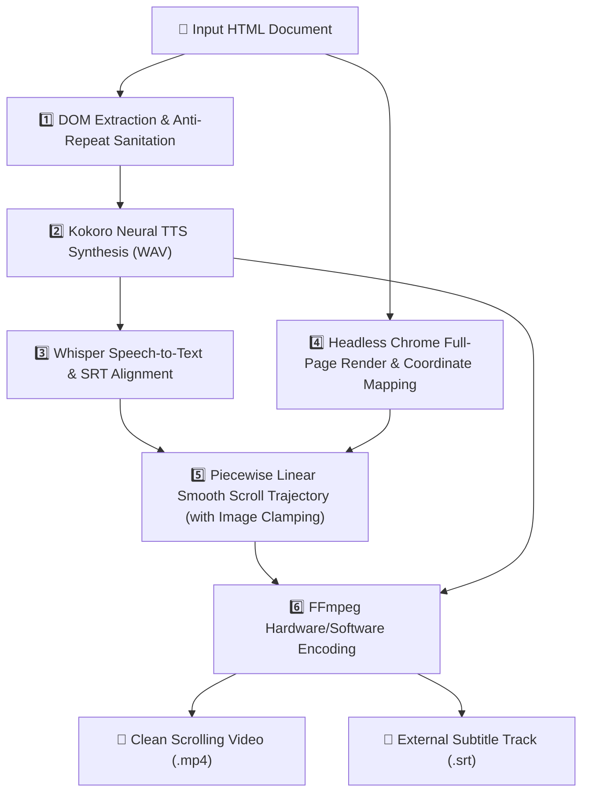

# 🎬 HTML to Scrolling Video Pipeline

[](https://www.python.org/)
[](https://github.com/nazdridoy/kokoro-tts)
[](https://github.com/openai/whisper)
[](https://ffmpeg.org/)
[](LICENSE)

An autonomous, turnkey pipeline that transforms formatted HTML stories, articles, and speculative manuscripts into **high-definition, vertical-scrolling cinematic videos** with studio-grade neural voice narration, millisecond-accurate speech alignment, and independent synchronized subtitles.

---

## ✨ Features

- 📜 **Turnkey HTML-to-Video**: Convert any structured HTML document, essay, or blog post into a 60fps vertical scrolling MP4 video.
- 🎙️ **Kokoro Neural Voice Narration**: Uses local 82M-parameter Kokoro TTS models for human-like pacing, intonation, and clarity without external API costs or rate limits.
- 🎯 **Whisper-Locked Camera Synchronization**: Speech timestamps extracted via OpenAI Whisper map directly to DOM bounding box coordinates. Zero camera drift across 30+ minute long-form documents.
- 🖼️ **Velocity-Clamped Visual Transitions**: Intelligently glides through diagrams, SVG illustrations, and image blocks at comfortable reading speeds rather than abruptly jumping or lurching.
- 💬 **Clean Video + Independent Subtitles (`.srt`)**: Videos are rendered clean without burned-in text overlays, while a companion `.srt` file is generated alongside the video for YouTube, VLC, or MPV closed captions.
- 🛡️ **Audio Repeat & Glitch Elimination**: Ignores child DOM nodes whose parents were already synthesized (e.g. nested blockquotes or title duplicates) and cleans technical punctuation (e.g. `//` to dashes) so speech flows naturally.
- 📐 **Smart DOM Boundaries**: Accurately computes page footer coordinates to ensure the camera gracefully stops at the document's end without scrolling into blank canvas space.

---

## 🚀 Quick Start

### 1. Set Up Environment & Install Dependencies
For detailed step-by-step instructions, see **[INSTALLATION.md](INSTALLATION.md)**.

```bash
# 1. Create and activate a Python virtual environment
python3 -m venv venv
source venv/bin/activate

# 2. Install requirements
pip install -r requirements.txt

# 3. Download the Kokoro ONNX model and voice embeddings
wget https://github.com/nazdridoy/kokoro-tts/releases/download/v1.0.0/kokoro-v1.0.onnx
wget https://github.com/nazdridoy/kokoro-tts/releases/download/v1.0.0/voices-v1.0.bin
```

### 2. Generate Your First Video

```bash
python3 html2scrolling_video_nosubs.py your_document.html --voice am_michael --output my_story.mp4
```

This will produce:
- **`my_story.mp4`**: High-definition, smooth scrolling video with uncompressed AAC audio.
- **`my_story.srt`**: Perfectly synchronized subtitle file.

---

## 📖 Command-Line Usage

```bash
python3 html2scrolling_video_nosubs.py <input.html> [OPTIONS]
```

### Options:
| Flag | Default | Description |
| :--- | :--- | :--- |
| `<input.html>` | *(Required)* | Path to the input HTML document. |
| `--voice` | `am_michael` | Voice profile for narration (see table below). |
| `--output` | `output_scrolling_video.mp4` | Name and destination of the rendered MP4 video. |

---

## 🎙️ Recommended Voices

Kokoro includes over 50 studio voices. Here are some of the most popular:

| Voice Code | Accent / Gender | Description |
| :--- | :--- | :--- |
| `am_michael` | American Male | Deep, authoritative, and cinematic (great for essays and stories). |
| `am_adam` | American Male | Clear, modern, and energetic narration. |
| `af_bella` | American Female | Warm, balanced, and expressive. |
| `af_sarah` | American Female | Crisp, articulate, and professional. |
| `af_nicole` | American Female | Soft, calm, and soothing. |
| `bm_george` | British Male | Classic, documentary-style British delivery. |
| `bf_emma` | British Female | Poised, clear, and elegant British narration. |

---

## 🎞️ Previewing Video & Subtitles

Since subtitles are kept external (`.srt`), you can preview the video with closed captions toggled on:

### Using `mpv`:
```bash
mpv my_story.mp4 --sub-file=my_story.srt
```

### Using `vlc`:
```bash
vlc my_story.mp4 --sub-file=my_story.srt
```

---

## 🏗️ Pipeline Architecture



1. **DOM Extraction**: Cleans HTML formatting anomalies, extracts headings and paragraphs, eliminates nested repetitions, and converts raw technical characters to speech-friendly pauses.
2. **TTS Synthesis**: Generates full narration with Kokoro-TTS and measures exact audio length with `ffprobe`.
3. **Whisper Alignment**: Transcribes synthesized audio, recording precise word and sentence start/end timestamps.
4. **Chrome Layout Inspection**: Renders the complete HTML in headless Google Chrome at native aspect ratio and extracts DOM pixel coordinates for all headings, text, and SVG/image elements via base64 JSON payload.
5. **Camera Trajectory Calculation**: Builds a continuous piecewise camera scroll function that synchronizes the viewport with spoken words and applies bidirectional velocity clamping across graphics.
6. **FFmpeg Render**: Crops the high-resolution page texture and renders the final MP4 with high-bitrate AAC audio.

---

## 📂 Repository Scripts

- **`html2scrolling_video_nosubs.py`** *(Recommended)*: Produces a clean, cinematic video without burned-in subtitles, glides smoothly over images, and keeps the `.srt` file separate.
- **`html_to_scrolling_video.py`**: Legacy version that burns subtitle text directly into the video stream.

---

## 📄 License

This project is licensed under the MIT License. See [LICENSE](LICENSE) for details.
